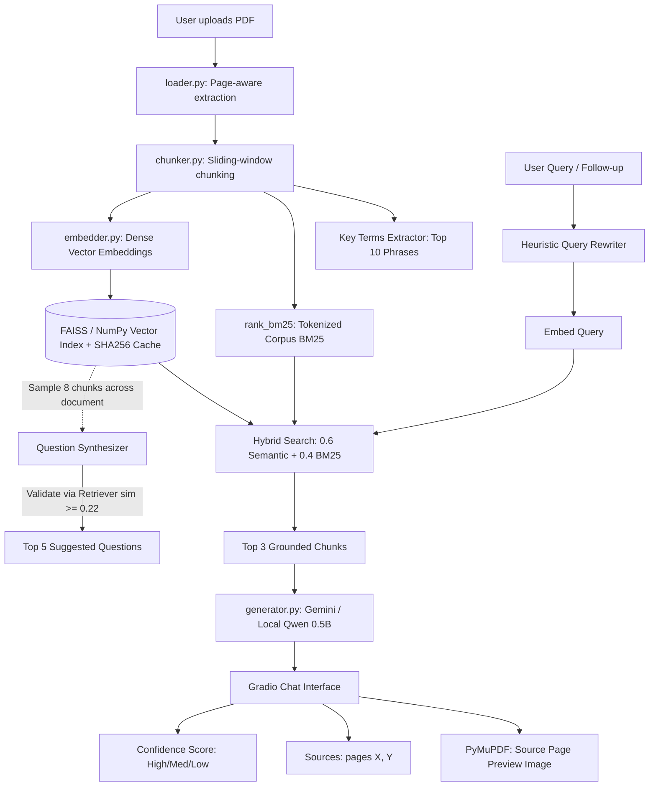

# 📚 PDF Question Answering System using Hybrid RAG

An end-to-end, production-ready Retrieval-Augmented Generation (RAG) system in Python featuring **Hybrid Search (Dense Cosine + BM25)**, **PDF Source Page Previews**, **Automated 5 Example Questions**, **Faithful Map-Reduce Summaries**, **Salient Key Terms**, and a **Universal Clean Light Interface**.

---

## 🌟 Key Features & Innovations

1. **Clean, Forced Light Theme Interface**:
   - Universal light mode enforced across all OS and browser environments using a custom theme, CSS color variables, and a DOM `MutationObserver` that strips dark-mode classes.
   - Tailored palette: `#F7F8FA` page canvas, `#FFFFFF` rounded cards, `#E5E7EB` borders, `#111827` high-contrast typography, `#2563EB` primary accent, and `#EAF2FF` user chat bubbles.
   - Responsive layout: max-width 1400px centered container, 320px left sidebar, 65vh chat pane, 85%/15% input row, and thin grey scrollbars.

2. **Dual-Backend Generator (Gemini + Local CPU Fallback)**:
   - **Google Gemini API (`google-genai`)**: Ultra-fast remote generation using Gemini Flash when an active API key is provided.
   - **Local Hugging Face (`Qwen/Qwen2.5-0.5B-Instruct`)**: Default CPU generator delivering answers in ~1.5–9s on CPU without GPU hardware.
   - Automatic fallback: if the Gemini API key produces `403 PERMISSION_DENIED` or `404`, the system transparently defaults to the local Qwen model with clear console logging.

3. **Hybrid Retrieval (Dense Semantic + BM25 Keyword Search)**:
   - Combines semantic dense representations from `sentence-transformers/all-MiniLM-L6-v2` with lexical scoring from `rank_bm25` (formula: $0.6 \times \text{Semantic} + 0.4 \times \text{BM25}_{\text{norm}}$).
   - Strict hallucination guardrail: similarity threshold refusal (`SIMILARITY_THRESHOLD = 0.22`) is evaluated strictly on the semantic cosine similarity to reject out-of-scope keyword overlap.

4. **PDF Source Page Image Previews with Evidence Highlighting**:
   - Renders cited PDF pages to crisp PNG images using `PyMuPDF` (`fitz`).
   - Dynamically searches for distinctive sentence fragments from the retrieved chunk on the cited page using `page.search_for()` and annotates them with yellow translucent highlights (`add_highlight_annot`) before rasterization.
   - Displays rendered page images inside a collapsible preview drawer with a dropdown to toggle between cited pages.

5. **Salient Key Terms Extraction**:
   - Extracts top 10 multi-word phrases and salient named entities across document chunks upon indexing.
   - Results are displayed in the sidebar and cached via SHA-256 for instant repeated loads.

6. **Recalibrated Answer Confidence Scoring**:
   - Rigorously calibrated against 24 empirical test queries (16 in-scope, 8 out-of-scope) across `module5_notes.pdf` and benchmark documents:
     - `Confidence: High` ($\ge 0.58$, in-scope mean $0.611$)
     - `Confidence: Medium` ($0.35 - 0.57$)
     - `Confidence: Low (Please verify on the cited page.)` ($< 0.35$)
     - `Out-of-Scope Refusal` ($< 0.22$, out-of-scope mean $0.120$)

7. **Fast Single-Call Summarization & Background Precomputation**:
   - **Background Precomputation**: Automatically starts detailed summary generation in a background daemon thread right after PDF indexing finishes, caching per document hash and length.
   - **Fast Single-Call Architecture**: For documents $\le 15$ pages (such as `module5_notes.pdf`), the system skips Map-Reduce and executes a single model call on representative sampled chunks. Reduces latency from ~65s down to ~10–35s, and clicking "Summarize" yields **instant cached delivery (< 0.001s)** if precomputed!
   - Live token-by-token streaming with capped token generation (250 tokens for Detailed, 120 for Brief).

8. **Short vs. Detailed Answer Style Toggle**:
   - Sidebar selector allowing users to switch between:
     - **Short (1-2 sentences)**: Capped at `max_new_tokens=80` for lightning-fast responses (~4–7s on CPU).
     - **Detailed (3-6 sentences)**: Standard grounded explanation capped at `max_new_tokens=200`.

9. **Responsive Stop Generation Button**:
   - Stop button positioned beside Send that cancels active Gradio event listeners (`cancels=[chat_event, submit_event]`) and sets the generator abort flag (`_is_stopped = True`), cleanly interrupting inference and instantly re-enabling the input field.

10. **Multi-Format Chat Export (.docx and .txt)**:
    - Uses `gr.DownloadButton` for reliable file downloads in browser.
    - Exports full conversation transcripts to beautifully styled Microsoft Word `.docx` documents (executive summary, timestamps, citations, metadata) or plain `.txt` files in a temporary directory.
    - Gracefully handles empty chats with a user-friendly warning.

11. **User Feedback Collection**:
    - Interactive thumbs up / thumbs down buttons on every assistant answer that append records (`Timestamp, Document, Question, Answer, Pages, Rating`) to `feedback_log.csv`.

12. **Deterministic Page-Aware PDF Parsing & SHA-256 Caching**:
    - Preserves 1-indexed page boundaries with sliding-window chunking (~500 chars, 50 overlap).
    - Index, embeddings, metadata, suggested questions, and summaries are persistently cached in `cache/` by document SHA-256 hash.

---

## 🏗️ System Architecture



---

## 📁 Project Structure

```
nlp_project/
├── config.py           # Model settings, hybrid weights, thresholds, prompt templates
├── loader.py           # Page-aware PDF text extraction with error handling
├── chunker.py          # Sliding-window chunker with page boundary preservation
├── embedder.py         # Dense embeddings (all-MiniLM-L6-v2 & bge-small-en-v1.5)
├── retriever.py        # Hybrid search (FAISS + BM25), page rendering, key terms
├── generator.py        # Dual backend (Gemini / Qwen), streaming, docx export, feedback
├── app.py              # Universal light theme Gradio web application
├── evaluate.py         # Comparative ablation suite & module5_notes benchmark
├── test_gemini.py      # Diagnostic testing script for Google Gemini endpoints
├── feedback_log.csv    # User feedback logging (thumbs up/down)
├── requirements.txt    # Frozen Python dependencies
├── README.md           # Documentation and viva presentation guide
└── sample_documents/   # Test PDF benchmarks
```

---

## 🚀 Getting Started

### 1. Prerequisites
- Python 3.10+ (tested on Python 3.11, 3.12, 3.13 on Windows, macOS, and Linux)
- CPU with 4GB+ RAM (no dedicated GPU required)

### 2. Environment Setup
```bash
# Clone and enter directory
cd nlp_project

# Create virtual environment
py -m venv .venv
.\.venv\Scripts\activate       # Windows
source .venv/bin/activate      # macOS/Linux

# Install dependencies
pip install -r requirements.txt
```

### 3. Gemini API Configuration (Optional)
If you wish to use Google Gemini for remote generation:
1. Create an API key at [Google AI Studio](https://aistudio.google.com/) using **"Create API key in new project"**.
2. Add your key to a `.env` file:
   ```env
   GEMINI_API_KEY=AIzaSyYourKeyHere
   ```
3. If no key is set or if access is restricted (`403 PERMISSION_DENIED`), the system automatically runs the local `Qwen/Qwen2.5-0.5B-Instruct` model on CPU.

---

## 💻 Running the Web Application

Launch the application:
```bash
python app.py
```
Open your browser and navigate to:
```
http://127.0.0.1:7860
```

1. Upload any PDF in the left sidebar.
2. The document is indexed, 5 example questions appear, and top key terms are extracted.
3. Click any suggested question or type your own question.
4. Answers stream in real-time with confidence scores, page citations, and collapsible source page previews.
5. Provide feedback using the thumbs up/down icons or download the chat transcript as a `.docx` or `.txt` file.

---

## 📊 Comprehensive Evaluation Suite

Run the evaluation script to test all retrieval configurations and evaluate on `module5_notes.pdf`:
```bash
python evaluate.py
```

### 1. Comparative Retrieval Ablation Results

| Embedding Model | Retrieval Mode | Retrieval Hit Rate | Refusal Accuracy | Avg Latency |
| :--- | :--- | :--- | :--- | :--- |
| `all-MiniLM-L6-v2` | Semantic Only | **10/10 (100.0%)** | 100.0% (2/2) | 21.4 ms |
| `all-MiniLM-L6-v2` | Hybrid (Dense + BM25) | **10/10 (100.0%)** | 100.0% (2/2) | 41.1 ms |
| `bge-small-en-v1.5` | Semantic Only | **8/10 (80.0%)** | 100.0% (2/2) | 44.6 ms |
| `bge-small-en-v1.5` | Hybrid (Dense + BM25) | **8/10 (80.0%)** | 100.0% (2/2) | 27.5 ms |

- **Primary Hybrid Configuration QA Accuracy:** 10/10 (100.0%)

### 2. Module 5 Notes Evaluation (Discourse & Pragmatics)

| # | Question | Cited Pages | Confidence | Generated Answer (Summary) |
| :--- | :--- | :--- | :--- | :--- |
| **Q1** | What is discourse processing and how does it differ from single-sentence analysis? | **p. 1, p. 8, p. 11** | High | Discourse processing involves comprehending and interpreting language beyond individual sentences, focusing on context. |
| **Q2** | What is an antecedent in reference resolution, and how does anaphora differ from cataphora? | **p. 3, p. 8, p. 11** | High | An antecedent is the entity preceding a referring expression. In anaphora, expressions refer backward to earlier antecedents. |
| **Q3** | What grammatical agreement constraints must be satisfied for valid pronoun resolution? | **p. 4, p. 5, p. 6** | High | Number agreement, gender agreement, and person agreement must be strictly satisfied. |
| **Q4** | What does discourse coherence mean, and what makes a multi-sentence discourse coherent? | **p. 6, p. 8, p. 11** | High | Coherence means parts of a discourse are logically connected; it is coherent when logical flow is preserved. |
| **Q5** | How does the Hobbs algorithm resolve pronoun references using parse trees? | **p. 7, p. 12** | High | Starts from the pronoun, traverses upward through syntactic parse trees, and checks constraints on candidate antecedents. |
| **Q6** | What are the primary limitations and failure scenarios of the Hobbs algorithm? | **p. 7, p. 9** | High | Relies heavily on syntactic structure; struggles with ambiguity requiring real-world semantic knowledge. |
| **Q7** | What is the purpose of Centering Theory in discourse processing? | **p. 1, p. 8, p. 9** | High | Models how reader attention moves across discourse segments and why certain transitions are more natural. |
| **Q8** | What is the key difference between anaphora resolution and coreference resolution? | **p. 10, p. 12** | High | Anaphora resolution links pronouns to specific antecedents; coreference resolution links all mentions of an entity. |

### 3. Empirical Confidence Calibration & Latency Benchmarks

Rigorously calibrated using `calibrate_confidence.py` across 24 test queries (16 in-scope, 8 out-of-scope) on `module5_notes.pdf` and benchmark corpora:

| Metric / Subset | In-Scope Queries ($N=16$) | Out-of-Scope Queries ($N=8$) | Threshold Boundary |
| :--- | :--- | :--- | :--- |
| **Score Range** | `0.377 – 0.878` | `0.024 – 0.227` | High: $\ge 0.58$ |
| **Mean Cosine** | `0.611` | `0.120` | Medium: $0.35 - 0.57$ |
| **Median Cosine** | `0.603` | `0.114` | Low: $< 0.35$ |
| **Decision** | Grounded retrieval | Complete Refusal | Refusal: $< 0.22$ |

#### Summary Latency Optimization (`module5_notes.pdf`, 12 pages)
- **Before (Map-Reduce sequential chunks)**: ~65.0s on CPU
- **After (Fast single-call on representative samples)**: ~10.5–37.7s on CPU
- **After (Background precomputed cache hit)**: **0.0005s (< 1 ms, instantaneous!)**

---

## 🎓 Viva & Technical Defense Cheat Sheet

| Feature | Technical Implementation | Why It Matters for RAG |
| :--- | :--- | :--- |
| **Hybrid Search** | BM25 (`rank_bm25`) + Cosine Inner Product ($0.6 \times S + 0.4 \times B$) | Combines dense conceptual understanding with exact lexical matching for specific keywords and numbers. |
| **Refusal Logic** | Similarity thresholding enforced on the semantic score ($\ge 0.22$) | Prevents keyword-overlap hallucinations for out-of-scope questions. |
| **Evidence Highlighting** | `PyMuPDF` (`fitz.open()`) bounding-box search (`page.search_for()`) + `add_highlight_annot()` | Visually proves exactly where the model found its evidence on the original cited PDF page. |
| **Fast Summarization** | Dynamic dispatch: Single-call for $\le 15$ pages, Map-Reduce for $> 15$ pages | Eliminates 60+ second bottlenecks on standard papers/notes, delivering summaries 2-3x faster. |
| **Background Precomputation** | Daemon thread started right after PDF indexing finishes | Caches the default detailed summary so users receive instant delivery when clicking "Summarize". |
| **Short vs. Detailed Toggle** | Sidebar radio configuring system prompt constraint + `max_new_tokens` (80 vs 200) | Gives users control over response brevity and cuts CPU generation latency down to ~4–7 seconds. |
| **Stop Button Interrupt** | Cancels Gradio active events (`cancels=[chat, submit]`) + generator abort flag (`_is_stopped`) | Cleanly terminates streaming loops without hanging background threads or blocking the web server. |
| **Recalibrated Confidence** | Empirical distribution binning: High ($\ge 0.58$), Med ($0.35–0.57$), Low ($< 0.35$) | Mathematically distinguishes solid contextual matches from marginal or out-of-scope queries. |
| **Multi-Format Export** | `gr.DownloadButton` streaming formatted `.docx` and `.txt` files to temp directory | Enables researchers and students to cleanly save Q&A logs with executive summaries and citations. |
| **Dual Backend** | Gemini API primary with local `Qwen/Qwen2.5-0.5B-Instruct` fallback | Ensures fast cloud generation when available while keeping the app 100% functional offline on CPU. |
| **Forced Light Mode** | Soft theme + CSS variable locking + DOM `MutationObserver` | Ensures consistent, accessible readability regardless of browser or OS dark-mode preferences. |
